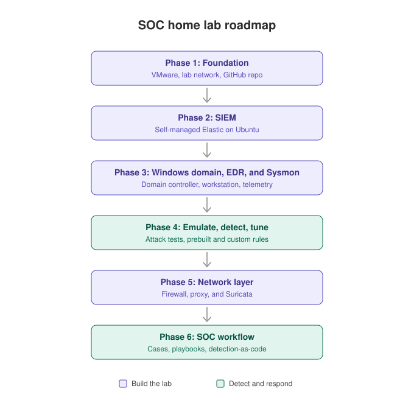

# soc-home-lab

A home security operations lab built on a single desktop PC with free tools.
I'm using it to practice detection engineering: generating attacks, writing
and tuning detections in Elastic, and investigating the alerts end to end.

## Goals

- Build a small enterprise-style environment with a SIEM, EDR, firewall, and proxy
- Tune Elastic's prebuilt detection rules and write custom EQL rules
- Document every phase so others can follow along or build their own

## Stack

- **SIEM:** Elastic Stack (self-managed)
- **Endpoint telemetry:** Elastic Defend and Sysmon
- **Environment:** Windows domain running on VMware Workstation Pro
- **Attack simulation:** Atomic Red Team
- **Network (planned):** OPNsense, proxy, and Suricata

## Roadmap

| Phase | Focus | Status |
|---|---|---|
| 1 | Foundation: hypervisor, lab network, repo | Completed |
| 2 | SIEM: Elastic Stack on Ubuntu | In Progress |
| 3 | Windows domain, EDR, and Sysmon | Planned |
| 4 | Emulate, detect, tune | Planned |
| 5 | Network layer | Planned |
| 6 | SOC workflow | Planned |

## Repo layout

- `docs/` write-ups for each phase
- `detections/` detection rules and tuning notes
- `diagrams/` architecture and roadmap diagrams
